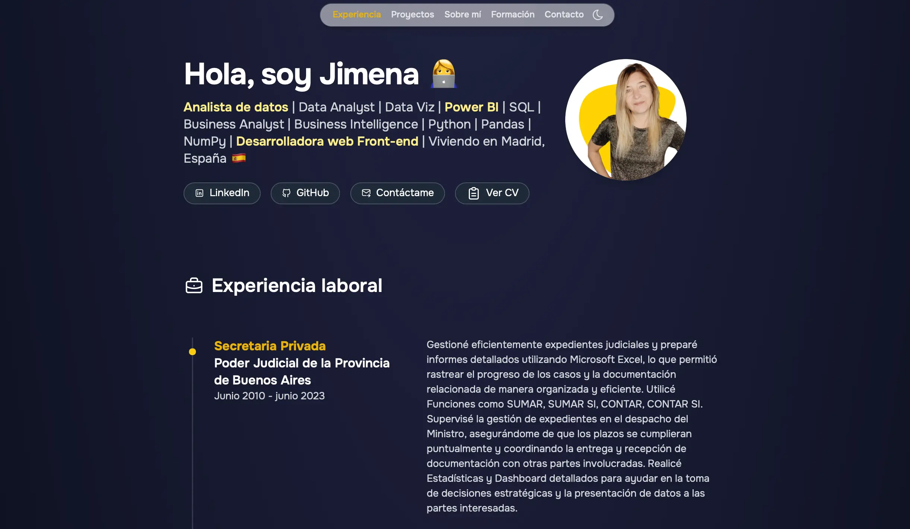

# Hola! 👩‍💻 Este es mi Portfolio

Repositorio de mi portfolio personal, diseñado para mostrar mi experiencia como **Fabric Data Engineer y Business Intelligence Consultant**. Certificada Microsoft DP-700 y DP-600. Speaker y Community Builder en la comunidad de datos.

Está construido con **Astro** y usa **Tailwind CSS**. Es responsivo y está optimizado para distintos tamaños de pantalla.



## Estructura del Proyecto

El sitio está dividido en las siguientes secciones:

1. **Hero** — saludo, posicionamiento, enlaces a redes (LinkedIn, GitHub, YouTube, Sessionize) y accesos directos al blog y al canal de YouTube.
2. **Sobre mí** — resumen profesional, trayectoria y rol en la comunidad.
3. **Experiencia laboral** — timeline vertical con cada rol, empresa, fecha y descripción.
4. **Proyectos** — trabajos en Power BI, Python, SQL y desarrollo web, con enlaces a GitHub y a la demo del proyecto.
5. **Habilidades técnicas** — stack agrupado por categorías (Fabric & Data Engineering, BI & Analytics, Bases de datos, Programación, Desarrollo Web, Comunidad).
6. **Certificaciones** — DP-700 y DP-600 de Microsoft.
7. **Formación** — bootcamp, cursos y formación universitaria.
8. **Blog** — artículos sobre Microsoft Fabric, Power BI, Dataflows Gen2 y Business Intelligence.

## Tecnologías

- **Astro** — framework principal.
- **Tailwind CSS** — diseño y estilos.
- **TypeScript** — tipos y seguridad.
- **@astrojs/sitemap** — sitemap automático para SEO.

## Configuración

```bash
git clone https://github.com/JimenaCambronero/JimenaCambroneroPorfolio.git
cd JimenaCambroneroPorfolio
npm install
npm run dev
```

Esto inicia el servidor de desarrollo local.

Para generar el build de producción:

```bash
npm run build
```

Los archivos estáticos quedan en `dist/`, listos para desplegar.

---

Si te gusta el proyecto, podés dejar una ⭐️ en el repo. ¡Gracias! 🦄
